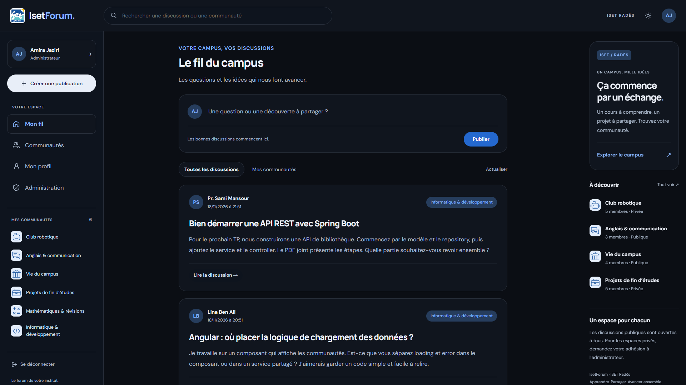
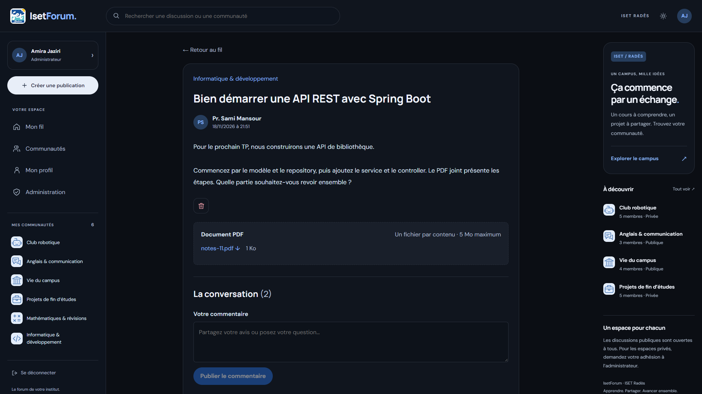
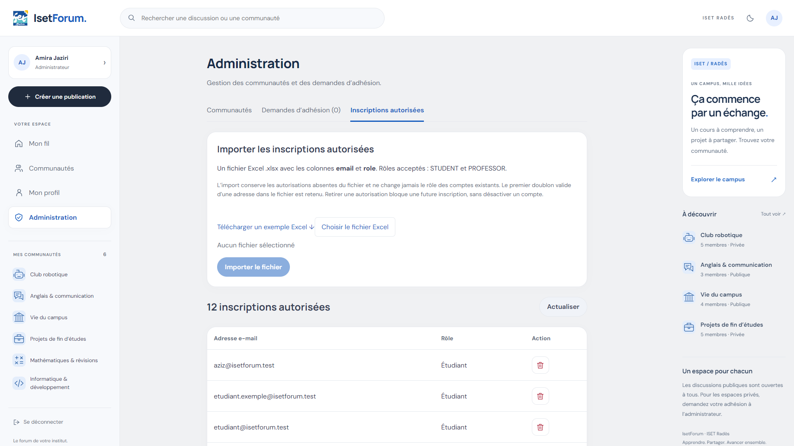

<div align="center">
  
  <h1>IsetForum</h1>
  <p><strong>Un campus. Mille idées. Une communauté pour les faire grandir.</strong></p>
  <p>Forum académique pour les étudiants et enseignants de l’ISET Radès.</p>
  <p>
    
    
    
    
  </p>
  <p>
    <a href="#aperçu">Aperçu</a> ·
    <a href="#fonctionnalités">Fonctionnalités</a> ·
    <a href="#installation">Installation</a> ·
    <a href="#architecture">Architecture</a> ·
    <a href="#tests">Tests</a>
  </p>
</div>

## Le projet

IsetForum est un projet académique de forum : créer des communautés, échanger entre étudiants et enseignants, et partager des ressources pédagogiques. L’interface française s’inspire de la simplicité de Reddit, avec l’identité de l’ISET Radès : bleu et blanc, textes lisibles et mode sombre au choix.

Le projet conserve une architecture simple : un backend Spring Boot organisé en couches, un frontend Angular et une base MySQL gérée localement avec Laragon/phpMyAdmin. Les parcours du forum et de l’administration utilisent les API réelles et des données persistantes.

## Fonctionnalités

- Inscription étudiante ou enseignante sur autorisation importée depuis Excel.
- Confirmation par e-mail, renvoi du lien, connexion et session sécurisée avec CSRF.
- Communautés publiques et privées ; adhésion directe ou demande approuvée par un administrateur.
- Publications et commentaires : création, lecture, modification et suppression selon les droits.
- PDF attachés aux communautés et publications, avec téléchargement protégé.
- Administration des communautés, demandes d’adhésion et autorisations d’inscription.
- Recherche dans le fil, profil personnel, thèmes clair et sombre, visuels thématiques locaux.

Les présentations des communautés sont publiques. Leurs contenus publics sont lisibles sans connexion ; les contenus privés et leurs PDF sont réservés aux membres actifs et aux administrateurs. Écrire exige une adhésion active. L’auteur vient toujours de la session. Votes, favoris, notifications et réponses imbriquées ne sont pas implémentés.

## Aperçu


<details>
<summary>Connexion, thème sombre, discussion et administration</summary>






</details>

Les captures montrent un viewport desktop **1920 × 1080 (16:9)**, sans toute la page déroulante. Le fil reste centré entre les panneaux latéraux. Les améliorations visuelles sont destinées au desktop ; une adaptation élémentaire existe sur écran étroit.

## Installation

### Prérequis

- JDK 17 ou supérieur ; Maven Wrapper fourni.
- MySQL 8, par exemple avec Laragon. phpMyAdmin sert à consulter la base.
- Node.js 22.19 ou supérieur compatible Angular 21, npm et Angular CLI 21 pour la commande directe `ng serve`.
- Docker Desktop démarré avec Docker Compose pour Mailpit.

### 1. MySQL et Mailpit

Démarrer MySQL dans Laragon. Depuis la racine du dépôt :

```powershell
docker compose up -d mailpit
docker compose ps
```

Mailpit reçoit les e-mails sur **localhost:1025**. Ouvrir sa boîte sur **http://localhost:8025**. Les ports Compose sont liés à 127.0.0.1 uniquement ; les messages restent dans le volume Docker local. Si une instance Mailpit utilise déjà ces ports, la conserver ou l’arrêter avant de lancer celle de Compose.

### 2. Backend Spring Boot

Dans un terminal PowerShell :

```powershell
cd backend
$env:DB_URL='jdbc:mysql://localhost:3306/isetforum?createDatabaseIfNotExist=true'
$env:DB_USERNAME='root'
$env:DB_PASSWORD=''
.\mvnw.cmd spring-boot:run "-Dspring-boot.run.profiles=dev"
```

Le serveur écoute sur http://localhost:8080. Flyway applique les migrations V1 à V5 ; Hibernate valide ensuite le schéma. Les migrations préservent les comptes existants. Dans IntelliJ, ouvrir `backend/pom.xml`, sélectionner le JDK et lancer `com.example.demo.DemoApplication` avec le profil actif `dev`.

Le profil dev utilise Mailpit par défaut, sans authentification SMTP ni STARTTLS. Aucun lien de confirmation n’est écrit dans un fichier ou dans les logs. Si Mailpit est indisponible, l’inscription retourne 503 et la création du compte est annulée : démarrer Mailpit puis réessayer.

### 3. Frontend Angular

Dans un autre terminal PowerShell :

```powershell
cd frontend
npm ci
ng serve
```

Ouvrir http://localhost:4200. Le proxy Angular transmet `/api` au backend sur 8080. Sans CLI global, utiliser `npm start`, qui lance le CLI installé dans le projet.

### 4. Tester une inscription

1. Se connecter avec l’administrateur local : `admin@isetforum.test`, mot de passe initial `IsetForumDev!2026`.
2. Ouvrir Administration → Inscriptions autorisées. Importer [l’exemple Excel](docs/examples/inscriptions-autorisees.xlsx), colonnes `email` et `role` : STUDENT ou PROFESSOR.
3. Se déconnecter et inscrire `etudiant.exemple@isetforum.test` ou `prof.exemple@isetforum.test`.
4. Ouvrir http://localhost:8025, lire « Confirmez votre compte IsetForum », puis cliquer sur le lien.
5. Se connecter au forum. Avant confirmation, la connexion est refusée.

Le lien expire après 24 heures et ne fonctionne qu’une fois. Le renvoi est disponible sur `/confirmation` après une minute et remplace le précédent lien. Un envoi échoué conserve l’ancien lien. Les e-mails fictifs restent dans Mailpit et ne sont pas expédiés sur Internet.

### Données d’exemple facultatives

Pour explorer une interface déjà remplie :

```powershell
cd backend
.\mvnw.cmd spring-boot:run "-Dspring-boot.run.profiles=dev,showcase"
```

Sur une base neuve, ce profil ajoute 9 comptes fictifs, 6 communautés publiques/privées, 13 publications, 26 commentaires et 12 PDF. Il conserve les comptes et communautés existants et ne remet pas leurs mots de passe à zéro.

| Compte local | Rôle | Mot de passe initial |
| --- | --- | --- |
| admin@isetforum.test | Administrateur | IsetForumDev!2026 |
| etudiant@isetforum.test | Étudiant | IsetForumDev!2026 |
| professeur@isetforum.test | Enseignant | IsetForumDev!2026 |

`DEV_SEED_PASSWORD` permet de choisir un autre mot de passe **avant** la première création des comptes de développement.

## Configuration

[backend/.env.example](backend/.env.example) documente les variables. Spring Boot ne lit pas automatiquement ce fichier : définir les variables dans PowerShell avec `$env:NOM='valeur'`, ou dans la configuration d’exécution de l’IDE.

| Variables | Usage |
| --- | --- |
| DB_URL, DB_USERNAME, DB_PASSWORD | Connexion MySQL |
| FRONTEND_URL | Origine des liens de confirmation ; défaut http://localhost:4200 |
| DEV_SMTP_HOST, DEV_SMTP_PORT | Mailpit en profil dev ; localhost et 1025 |
| SMTP_HOST, SMTP_PORT | Serveur SMTP hors profil dev |
| SMTP_USERNAME, SMTP_PASSWORD | Identifiants du fournisseur SMTP |
| SMTP_AUTH, SMTP_STARTTLS | Authentification et chiffrement SMTP hors dev ; true par défaut |
| MAIL_FROM | Expéditeur ; noreply@isetforum.tn par défaut |
| PDF_MAX_BYTES | Limite d’un PDF ; 5242880 octets par défaut |

La configuration SMTP de production reste indépendante du profil dev. Le mode de journalisation console a été supprimé. Un fournisseur SMTP externe doit être configuré et vérifié avant tout déploiement.

## Architecture

```text
IsetForum/
├── backend/
│   ├── src/main/java/com/example/demo/
│   │   ├── controller/   Routes HTTP et validation des DTO
│   │   ├── service/      Règles métier et transactions
│   │   ├── repository/   Accès Spring Data JPA
│   │   ├── model/        Entités MySQL
│   │   ├── dto/          Entrées et réponses API
│   │   ├── config/       Sécurité et données de développement
│   │   └── exception/    Réponses d’erreur
│   └── src/main/resources/db/migration/
├── frontend/             Angular : core, layout, features et shared
├── docs/                 Référence backend, exemples et captures
├── scripts/              Outils locaux
└── compose.yaml          Mailpit local
```

Le flux reste `controller → service → repository → MySQL`. User est l’unique entité de compte ; les autorisations d’inscription sont une liste d’adresses et de rôles, pas une seconde catégorie d’utilisateurs.

Consulter la [référence complète du backend](docs/architecture.md) pour le modèle, les permissions, les routes, les transactions et les tests. Voir aussi le [frontend](frontend/README.md) et [Contribuer](CONTRIBUTING.md).

## Tests

```powershell
cd backend
.\mvnw.cmd test
cd ../frontend
npm test
npm run build
```

Les tests Java utilisent H2 et un transport mail simulé. Ils ne nécessitent ni Mailpit ni MySQL. Les migrations et les comportements SMTP doivent aussi être vérifiés en intégration.

Le parcours navigateur réel utilise Edge, Mailpit et une **base MySQL dédiée**, car il crée des comptes et des contenus. Les commandes complètes, les cas de panne SMTP et la vérification après redémarrage sont dans la [documentation backend](docs/architecture.md#tests-et-vérifications).

### Vérifications réalisées

| Vérification | Résultat |
| --- | --- |
| Tests backend | 53 tests Java réussis |
| Tests frontend | 9 tests Angular réussis |
| Build Angular de production | Réussi |
| Confirmation et renvoi | E-mails reçus dans Mailpit, liens ouverts et usage unique vérifié |
| SMTP indisponible | Réponse 503 et inscription annulée ; nouvelle tentative possible avec la même adresse |
| Permissions | Accès autorisés et refusés vérifiés sur les communautés privées et leurs PDF |
| Persistance MySQL | Comptes, adhésions, commentaires et fichiers PDF vérifiés après redémarrage |
| Interface desktop | Modes clair/sombre, visuels locaux, boutons à icônes, focus clavier et réduction des animations vérifiés |
| Documentation | Liens locaux et cinq captures 1920 × 1080 vérifiés |

Le parcours e-mail a été testé avec l’instance Mailpit locale existante. La configuration Docker Compose a été validée, mais le démarrage du conteneur reste à vérifier avec Docker Desktop actif. L’envoi par un fournisseur SMTP de production externe reste également à vérifier.

### Régénérer les captures

Avec les exemples MySQL présents, le backend démarré et Microsoft Edge installé :

```powershell
cd frontend
npm run build
npm run screenshots
```

Le script consulte le contenu existant et produit cinq images 16:9 dans `docs/images`. Configuration facultative : `ISETFORUM_API_URL`, `ISETFORUM_CAPTURE_EMAIL`, `ISETFORUM_CAPTURE_PASSWORD`.

Le logo ISET est fourni par le projet. Les visuels thématiques sont des SVG locaux. La référence Contra/Mobbin et les fils Reddit ont guidé la présentation.
