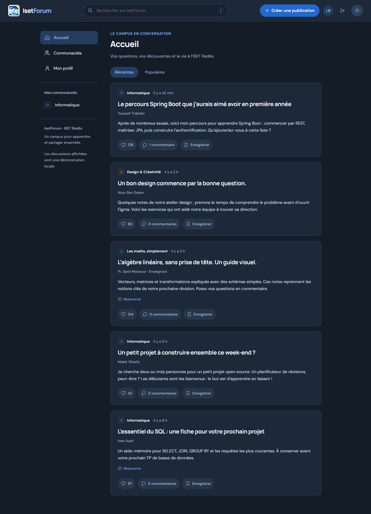
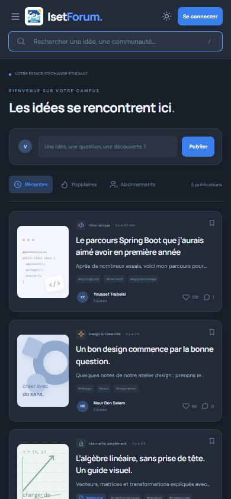

<div align="center">
  
  <h1>IsetForum</h1>
  <p><strong>Un campus. Mille idées. Une communauté pour les faire grandir.</strong></p>
  <p>Forum académique pour les étudiants et enseignants de l’ISET Radès.</p>
  <p>
    
    
    
    
  </p>
  <p>
    <a href="#aperçu">Aperçu</a> ·
    <a href="#fonctionnalités">Fonctionnalités</a> ·
    <a href="#installation">Installation</a> ·
    <a href="#architecture">Architecture</a> ·
    <a href="#tests">Tests</a>
  </p>
</div>

## Le projet

IsetForum est un projet académique de forum : créer des communautés, échanger entre étudiants et enseignants, et partager des ressources pédagogiques. L’interface française s’inspire de la simplicité de Reddit, avec l’identité de l’ISET Radès : bleu et blanc par défaut, textes lisibles et mode sombre au choix.

Le projet conserve une architecture simple : un backend Spring Boot organisé en couches, un frontend Angular et une base MySQL gérée localement avec Laragon/phpMyAdmin.

### Priorité actuelle : le backend

Le développement se concentre actuellement sur les API Spring Boot, les règles métier et leur persistance dans MySQL. La structure en couches `controller`, `service`, `repository`, `model` et `dto` est conservée, avec des méthodes simples et des responsabilités claires.

Le frontend Angular existe déjà, mais son interface nécessite encore des ajustements. Les prochaines évolutions visuelles et le raccordement des fonctionnalités de démonstration aux API seront repris plus tard. Les captures ci-dessous présentent donc une interface provisoire.

## Aperçu


<details>
  <summary>Connexion, thème sombre et vue mobile</summary>

  **Connexion**

  

  **Thème sombre**

  

  **Version mobile**

  
</details>

## Fonctionnalités

| Fonctionnalité | Backend / MySQL | Interface Angular |
| --- | --- | --- |
| Inscription étudiante, connexion, déconnexion | Opérationnel | Connecté aux API |
| Session et restauration du compte | Opérationnel | Connecté aux API |
| Communautés publiques et privées | Opérationnel | Démonstration locale |
| Adhésions et demandes privées | Opérationnel | Démonstration locale |
| Validation par l’administrateur | Opérationnel | Démonstration locale |
| Publications, commentaires, likes et favoris | À implémenter | Démonstration locale |
| Ressources texte téléchargeables | À implémenter | Démonstration `.txt` |
| Pièces jointes et réinitialisation par e-mail | À implémenter | Non inclus |

L’interface permet déjà de rechercher, filtrer, publier dans la démonstration, commenter et enregistrer des publications. Les données de démonstration restent dans le navigateur et sont séparées par compte. Les communautés réelles du backend ne sont pas encore affichées par Angular : ce raccordement sera traité lors de la reprise du frontend.

### Pages retenues

- **Connexion / Inscription** : accès au compte et création d’un compte étudiant.
- **Accueil** : un fil central de discussions, triées par date ou popularité.
- **Communautés** : découverte et création des espaces publics et privés.
- **Une communauté** : présentation, adhésion et onglets Publications / Ressources.
- **Une publication** : lecture complète et commentaires, avec une adresse dédiée.
- **Mon profil** : informations du compte, publications personnelles et favoris.
- **Administration** : validation des demandes privées, réservée aux administrateurs.

Le menu principal contient Accueil, Communautés et Mon profil. L’accueil utilise deux colonnes, sans panneau de suggestions à droite. Les textes courants sont en 16 px, les titres de discussion en 20–22 px et les métadonnées en 14 px. Les anciennes adresses `/forum/favoris` et `/forum/ressources` restent accessibles et mènent aux espaces correspondants.

### Règles des communautés

- Étudiants, enseignants et administrateurs peuvent créer une communauté.
- Les noms et descriptions restent visibles par tous, même sans connexion.
- Une communauté publique accepte immédiatement les utilisateurs inscrits.
- Une communauté privée exige une validation de l’administrateur.
- Le créateur devient membre automatiquement et conserve son adhésion.
- Seuls le créateur et un administrateur peuvent modifier la communauté.
- Les contrôles d’accès sont appliqués dans le backend ; la session fournit l’identité de l’utilisateur.

## Technologies

| Partie | Technologies |
| --- | --- |
| Backend | Java 17, Spring Boot 3.5, Spring MVC |
| Sécurité | Spring Security, sessions HttpOnly, CSRF, BCrypt |
| Données | Spring Data JPA / Hibernate, MySQL, Flyway |
| Frontend | Angular 21, TypeScript, RxJS, CSS |
| Tests | JUnit 5, MockMvc, H2, Vitest, Playwright / Microsoft Edge |
| Outils | Maven Wrapper, npm, Git, IntelliJ IDEA, Laragon |

## Installation

### Prérequis

- JDK 17 ou supérieur.
- MySQL 8 lancé avec Laragon.
- Git.

Pour lancer également le frontend : Node.js compatible avec Angular 21 (Node **22.19** utilisé sur ce projet), npm et Angular CLI 21. Ces outils ne sont pas nécessaires pour travailler uniquement sur le backend.

### 1. Récupérer le projet

```bash
git clone https://github.com/teerentt/IsetForum.git
cd IsetForum
```

Le dépôt est privé : un accès GitHub autorisé est nécessaire pour le cloner.

### 2. Démarrer MySQL

Démarrez MySQL dans Laragon. La configuration locale reprend celle du projet initial :

| Paramètre | Valeur locale par défaut |
| --- | --- |
| Hôte | `localhost` |
| Port | `3306` |
| Base | `isetForum` |
| Utilisateur | `root` |
| Mot de passe | vide |

La base est créée si elle est absente, puis les migrations Flyway créent les tables. Hibernate valide ensuite le schéma. Ne modifiez pas les migrations déjà exécutées : ajoutez une nouvelle migration pour faire évoluer la base.

### 3. Lancer Spring Boot dans IntelliJ

1. Ouvrez `backend/pom.xml` dans IntelliJ et chargez les dépendances Maven.
2. Ouvrez `backend/src/main/java/com/example/demo/DemoApplication.java`.
3. Dans sa configuration d’exécution, renseignez les arguments de programme :

   ```text
   --spring.profiles.active=dev
   ```

4. Lancez `DemoApplication`. Le backend écoute sur **http://localhost:8080**.

Le profil `dev` crée les comptes et les communautés de développement uniquement s’ils sont absents. Il ne remplace pas les données existantes.

Alternative en terminal Windows, depuis la racine du dépôt :

```powershell
cd backend
.\mvnw.cmd spring-boot:run "-Dspring-boot.run.profiles=dev"
```

Sur Linux ou macOS :

```bash
cd backend
sh mvnw spring-boot:run -Dspring-boot.run.profiles=dev
```

Dans VS Code, ouvrez la racine `IsetForum/`, puis importez le projet Maven `backend/pom.xml`. Si le tableau Spring Boot reste vide après le déplacement, exécutez **Java: Import Java Projects into Workspace** depuis la palette de commandes. Si nécessaire, utilisez **Java: Clean Java Language Server Workspace**, puis laissez l’import Java se terminer.

### 4. Lancer Angular — facultatif pour le travail backend

Depuis le dossier `frontend` :

```bash
npm ci
```

Si Angular CLI n’est pas encore installé sur le poste :

```bash
npm install -g @angular/cli@21
```

Puis :

```bash
ng serve
```

Ouvrez **http://localhost:4200**. La page de connexion apparaît en premier ; le lien **Continuer en visiteur** ouvre les contenus publics.

Le proxy Angular est déjà configuré : `/api/**` est transmis au backend sur le port `8080`. MySQL et Spring Boot doivent être démarrés séparément. Sur Windows, Command Prompt permet d’utiliser `ng serve` sans modifier la politique d’exécution de PowerShell.

### Configuration optionnelle

Définissez ces variables dans la configuration d’exécution IntelliJ ou dans votre terminal :

| Variable | Fonction |
| --- | --- |
| `DB_URL` | URL JDBC complète de MySQL |
| `DB_USERNAME` | Utilisateur de la base |
| `DB_PASSWORD` | Mot de passe de la base |
| `DEV_SEED_PASSWORD` | Mot de passe choisi avant la première création des comptes de développement |
| `SESSION_COOKIE_SECURE` | `true` pour un environnement HTTPS |

Les paramètres sont lus par Spring Boot. Les secrets et paramètres personnels ne doivent pas être ajoutés dans Git.

### Comptes de développement

| Profil | Adresse e-mail | Mot de passe initial |
| --- | --- | --- |
| Étudiant | `etudiant@isetforum.test` | `IsetForumDev!2026` |
| Enseignant | `professeur@isetforum.test` | `IsetForumDev!2026` |
| Administrateur | `admin@isetforum.test` | `IsetForumDev!2026` |

Les inscriptions publiques créent uniquement des étudiants. Les comptes enseignants et administrateurs sont provisionnés séparément. Sans le profil `dev`, aucun de ces comptes n’est créé.

## Architecture

```text
IsetForum/
├── backend/             Application Spring Boot
│   ├── src/main/java/com/example/demo/
│   │   ├── DemoApplication.java
│   │   ├── config/      Sécurité et données de développement
│   │   ├── controller/  Points d’entrée HTTP par domaine
│   │   ├── dto/         Requêtes et réponses API
│   │   ├── enums/       Rôles, visibilités et statuts
│   │   ├── exception/   Gestion commune des erreurs
│   │   ├── model/       Entités utilisateur et communauté
│   │   ├── repository/  Accès aux données JPA
│   │   └── service/     Règles métier
│   ├── src/main/resources/
│   │   ├── application.properties
│   │   ├── application-dev.properties
│   │   └── db/migration/ Migrations Flyway
│   ├── src/test/        Tests backend
│   ├── .mvn/           Configuration du Maven Wrapper
│   ├── mvnw / mvnw.cmd
│   └── pom.xml
├── frontend/            Application Angular
│   ├── src/app/core/    Services, modèles et accès aux routes
│   ├── src/app/layout/  Structure et navigation
│   ├── src/app/features/Pages de l’application
│   └── src/app/shared/  Composants réutilisables
├── docs/                API, architecture et captures
└── scripts/             Vérification des parcours MySQL
```

Parcours d’une requête : **Controller → Service → Repository → MySQL**. Les packages sont regroupés par domaine à l’intérieur de chaque couche : `auth`, `user`, `community`, `membership` ou `admin`, selon leur responsabilité.

| Couche | Responsabilité |
| --- | --- |
| `controller` | Recevoir les requêtes HTTP et renvoyer les réponses API |
| `dto` | Définir les données d’entrée et de sortie |
| `service` | Appliquer les règles métier et gérer les transactions |
| `repository` | Accéder aux données avec Spring Data JPA |
| `model` | Représenter les entités stockées dans MySQL |
| `config` / `exception` | Configurer la sécurité et les données de développement, et centraliser les erreurs |

Le `pom.xml`, le Maven Wrapper et les sources Java appartiennent à `backend/`. Les commandes Maven s’exécutent dans ce dossier ; `ng serve` et les commandes npm s’exécutent dans `frontend/`. Aucun découpage en microservices ni infrastructure supplémentaire n’est nécessaire.

[Architecture détaillée](docs/architecture.md) · [API du Sprint 2](docs/sprint-2.md) · [Documentation Angular](frontend/README.md)

## API

| Domaine | Principales routes |
| --- | --- |
| Authentification | `/api/auth/register`, `/api/auth/login`, `/api/auth/me`, `/api/auth/logout`, `/api/auth/csrf` |
| Communautés | `/api/communities`, `/api/communities/{id}` |
| Adhésions | `/api/communities/{id}/membership`, `/api/memberships/mine` |
| Administration | `/api/admin/membership-requests` |

Les réponses sont en JSON. Les erreurs suivent `{ message, fields }`, avec des messages français. Les mots de passe et leurs hachages ne sont jamais exposés. L’authentification utilise une session `JSESSIONID` HttpOnly et SameSite=Lax. Les requêtes d’écriture nécessitent le jeton CSRF géré par Angular.

## Tests

Depuis `backend` :

```powershell
.\mvnw.cmd test
```

Depuis `frontend` :

```bash
npm test
npm run build
```

Avec le backend démarré en profil `dev` et Microsoft Edge installé :

```bash
npm run test:browser
```

Les tests Java utilisent H2, sans modifier MySQL. Les tests navigateur couvrent la connexion, l’inscription, les trois rôles, les sessions, les interactions du forum, le logo, les thèmes et les vues mobiles. Ils créent un compte étudiant de vérification dans MySQL et des captures dans `frontend/artifacts/`, ignoré par Git.

Pour vérifier les API du Sprint 2 sur MySQL, depuis la racine :

```bash
node scripts/verify-sprint2.mjs
```

Ce script crée deux communautés de vérification. Après redémarrage du backend :

```bash
node scripts/verify-sprint2.mjs --read-only
```

## Dépannage rapide

- **Connexion impossible** : vérifier que MySQL est démarré et que Spring Boot écoute sur `8080`.
- **Les nouvelles communautés ne sont pas visibles dans Angular** : l’interface utilise encore sa démonstration locale. Les API réelles sont disponibles séparément.
- **Erreur PowerShell sur `ng`** : utiliser Command Prompt ou `ng.cmd serve`.
- **Cache Maven inaccessible** : dans Command Prompt, ajouter `"-Dmaven.repo.local=%USERPROFILE%\.m2\repository"` à la commande Maven.
- **Classe `DemoApplication` introuvable après déplacement** : importer `backend/pom.xml`, recharger le projet Maven et relancer `com.example.demo.DemoApplication`.
- **Tableau Spring Boot vide dans VS Code** : réimporter les projets Java ; si nécessaire, nettoyer l’espace de travail du serveur Java et redémarrer VS Code.

## Feuille de route

### Backend — travail en cours et prochaines étapes

- [x] Authentification et inscription avec MySQL.
- [x] Communautés et adhésions côté backend.
- [ ] Ajouter les publications et commentaires au backend.
- [ ] Ajouter les pièces jointes et ressources partagées.
- [ ] Finaliser la modération et les notifications.

Chaque nouvelle fonctionnalité doit conserver les couches existantes, vérifier les droits d’accès côté serveur et être testée avant son raccordement à Angular.

### Frontend — à reprendre plus tard

- [x] Première interface française avec l’identité ISET et les thèmes clair/sombre.
- [ ] Poursuivre les ajustements du design et de la navigation.
- [ ] Relier les communautés et adhésions Angular aux API réelles.
- [ ] Remplacer progressivement les publications, commentaires et ressources de démonstration par les données du backend.

## Contribuer

Les conventions, commandes de vérification et exemples de commits sont dans [CONTRIBUTING.md](CONTRIBUTING.md).

## Références visuelles

La composition du forum s’inspire de la maquette fournie dans `frontend/src/app/assets/maquette.png`, liée à [Forum UI Design sur Figma Community](https://www.figma.com/community/file/1114929434468857549/forum-ui-design). Le logo ISET Radès a été fourni avec les assets du projet. L’interface est adaptée au contexte académique et développée en composants Angular.
